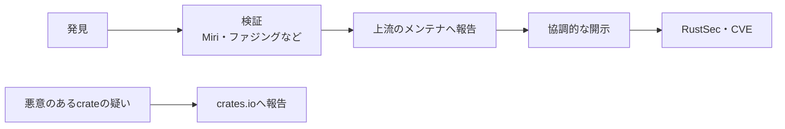

# 🦀 RustSecJP

### Rust security, in Japanese. ｜ Rustの安全を、日本語で。

[English](https://github.com/RustSecJP) ｜ **日本語**

*このページは英語版の翻訳です。内容が食い違う場合は英語版が優先されます。*

> [!IMPORTANT]
> RustSecJP は **非公式** のコミュニティです。RustSec(Rust Secure Code WG)、Rust Project、Rust Foundation とは提携しておらず、公式の組織ではありません。**RUSTSEC-** から始まる助言IDの発行も行いません。

---

## RustSecJP とは

Rustのセキュリティに関する知見を、**日本語で、検証できる形で**届ける非公式コミュニティです。脆弱性、サプライチェーン攻撃、バイナリ解析を、同じ「Rustを深く読む力」でつなぎます。

## 🧭 活動

| | 活動 | 内容 | 状況 |
|---|---|---|---|
| 📘 | **脆弱性報告の手引き** | 上流への報告、協調的な開示、RustSecへの助言の提出までの流れを日本語でまとめる | 🟡 準備中 |
| 🔍 | **検証済みの脆弱性報告** | unsoundness やメモリ安全性の問題を、Miri・ファジングなどで検証したうえで、上流のメンテナへ報告する | 🟡 準備中 |
| 🕵️ | **crate型マルウェアのキャンペーン分析** | `build.rs` や `proc-macro` を使う攻撃を、個別の助言ではなくキャンペーン単位で整理する(繋がりの根拠と確信度つき) | ⚪ 計画中 |
| 📰 | **助言・事件の日本語解説** | RustSecの助言やサプライチェーン事件の技術的な背景を、日本語で読み解く | ⚪ 計画中 |
| 🛡️ | **防御ガイド** | `cargo-audit` / `cargo-deny` / `cargo-vet` / Trusted Publishing の導入と運用を日本語で解説する | ⚪ 計画中 |
| 🧬 | **Rustバイナリの解析** | Rust製マルウェアの特徴(依存crateの組み合わせ、ビルド環境の痕跡など)の整理 | 🔒 取扱い規程の整備後 |
| 🎓 | **小さな勉強会** | unsafe Rust と Miri を読む輪読・ハンズオン | ⚪ 計画中 |

## 🔄 報告の流れ

## 🧪 方針

1. **検証できた情報だけを公開し、確信度(高・中・低)を明記します。**
2. **出典を明記します。** 他者の報告に拠る部分と、自分たちで確認した部分を分けて書きます。
3. **マルウェアの現物は公開しません。** ハッシュと説明のみを載せます。
4. **誤りが見つかった場合は、速やかに訂正します。**

## 🚨 悪意のあるcrateを見つけたら

RustSecJP は報告の窓口ではありません。疑わしいcrateは **crates.io** へ報告してください。

## 🤝 関わる

質問や指摘は、各リポジトリの Issues へお願いします。連絡先は準備中です。

---

**非公式** ｜ RustSec・Rust Project・Rust Foundation とは提携していません。

