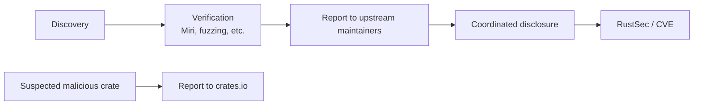

# 🦀 RustSecJP

### Rust security, in Japanese. ｜ Rustの安全を、日本語で。

**English** ｜ [日本語](https://github.com/RustSecJP/.github/blob/main/profile/README.ja.md)

> [!IMPORTANT]
> RustSecJP is an **unofficial** community. It is not affiliated with RustSec, the Rust Project, or the Rust Foundation, and does not issue RUSTSEC identifiers.

---

## What is RustSecJP?

An unofficial community that brings Rust security knowledge to Japanese readers **in a form that can be verified**. We connect vulnerabilities, supply-chain attacks, and binary analysis through the same skill: reading Rust deeply.

## 🧭 What we do

| | Activity | Description | Status |
|---|---|---|---|
| 📘 | **Reporting handbook** | A Japanese guide to the path from upstream reporting and coordinated disclosure to submitting an advisory to RustSec | 🟡 In preparation |
| 🔍 | **Verified vulnerability reports** | Reporting unsoundness and memory-safety issues to upstream maintainers after verifying them with Miri, fuzzing, and similar tools | 🟡 In preparation |
| 🕵️ | **Campaign analysis of malicious crates** | Organizing attacks that use `build.rs` and `proc-macro` per campaign rather than per advisory, with the evidence for each link and a confidence level | ⚪ Planned |
| 📰 | **Advisory and incident write-ups** | Japanese explanations of the technical background behind RustSec advisories and supply-chain incidents | ⚪ Planned |
| 🛡️ | **Defense guides** | Adopting and operating `cargo-audit`, `cargo-deny`, `cargo-vet`, and Trusted Publishing, in Japanese | ⚪ Planned |
| 🧬 | **Rust binary analysis** | Characterizing Rust-based malware (dependency crate sets, build-environment traces, and so on) | 🔒 After handling rules are in place |
| 🎓 | **Small study sessions** | Reading groups and hands-on sessions on unsafe Rust and Miri | ⚪ Planned |

## 🔄 Reporting flow

## 🧪 Principles

1. **We publish only what we have verified, with an explicit confidence level (high / medium / low).**
2. **We cite our sources,** and separate what others reported from what we confirmed ourselves.
3. **We never publish live malware.** Only hashes and descriptions.
4. **We correct mistakes promptly.**

## 🚨 Found a malicious crate?

RustSecJP is not a reporting channel. Please report suspected malicious crates to **crates.io**.

## 🤝 Get involved

Questions and corrections are welcome in the Issues of each repository. A contact address is in preparation.

---

**Unofficial** ｜ Not affiliated with RustSec, the Rust Project, or the Rust Foundation.

