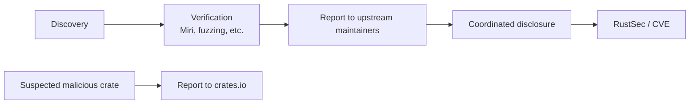
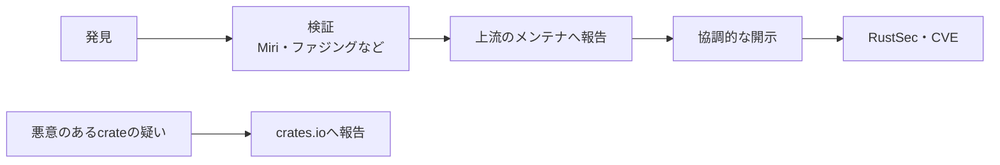

# 🦀 RustSecJP

### Rust security, in Japanese. ｜ Rustの安全を、日本語で。

[🇬🇧 English](#en) ｜ [🇯🇵 日本語](#ja)

*The English text is the canonical version; the Japanese text is a translation. ｜ 英語版が正本で、日本語版は翻訳です。*

> [!IMPORTANT]
> RustSecJP is an **unofficial** community. It is not affiliated with RustSec, the Rust Project, or the Rust Foundation, and does not issue RUSTSEC identifiers.
>
> RustSecJP は **非公式** のコミュニティです。RustSec(Rust Secure Code WG)、Rust Project、Rust Foundation とは提携しておらず、公式の組織ではありません。**RUSTSEC-** から始まる助言IDの発行も行いません。

---

## 🇬🇧 English

### What is RustSecJP?

An unofficial community that brings Rust security knowledge to Japanese readers **in a form that can be verified**. We connect vulnerabilities, supply-chain attacks, and binary analysis through the same skill: reading Rust deeply.

### 🧭 What we do

| | Activity | Description | Status |
|---|---|---|---|
| 📘 | **Reporting handbook** | A Japanese guide to the path from upstream reporting and coordinated disclosure to submitting an advisory to RustSec | 🟡 In preparation |
| 🔍 | **Verified vulnerability reports** | Reporting unsoundness and memory-safety issues to upstream maintainers after verifying them with Miri, fuzzing, and similar tools | 🟡 In preparation |
| 🕵️ | **Campaign analysis of malicious crates** | Organizing attacks that use `build.rs` and `proc-macro` per campaign rather than per advisory, with the evidence for each link and a confidence level | ⚪ Planned |
| 📰 | **Advisory and incident write-ups** | Japanese explanations of the technical background behind RustSec advisories and supply-chain incidents | ⚪ Planned |
| 🛡️ | **Defense guides** | Adopting and operating `cargo-audit`, `cargo-deny`, `cargo-vet`, and Trusted Publishing, in Japanese | ⚪ Planned |
| 🧬 | **Rust binary analysis** | Characterizing Rust-based malware (dependency crate sets, build-environment traces, and so on) | 🔒 After handling rules are in place |
| 🎓 | **Small study sessions** | Reading groups and hands-on sessions on unsafe Rust and Miri | ⚪ Planned |

### 🔄 Reporting flow

### 🧪 Principles

1. **We publish only what we have verified, with an explicit confidence level (high / medium / low).**
2. **We cite our sources,** and separate what others reported from what we confirmed ourselves.
3. **We never publish live malware.** Only hashes and descriptions.
4. **We correct mistakes promptly.**

### 🚨 Found a malicious crate?

RustSecJP is not a reporting channel. Please report suspected malicious crates to **crates.io**.

### 🤝 Get involved

Questions and corrections are welcome in the Issues of each repository. A contact address is in preparation.

---

## 🇯🇵 日本語

### RustSecJP とは

Rustのセキュリティに関する知見を、**日本語で、検証できる形で**届ける非公式コミュニティです。脆弱性、サプライチェーン攻撃、バイナリ解析を、同じ「Rustを深く読む力」でつなぎます。

### 🧭 活動

| | 活動 | 内容 | 状況 |
|---|---|---|---|
| 📘 | **脆弱性報告の手引き** | 上流への報告、協調的な開示、RustSecへの助言の提出までの流れを日本語でまとめる | 🟡 準備中 |
| 🔍 | **検証済みの脆弱性報告** | unsoundness やメモリ安全性の問題を、Miri・ファジングなどで検証したうえで、上流のメンテナへ報告する | 🟡 準備中 |
| 🕵️ | **crate型マルウェアのキャンペーン分析** | `build.rs` や `proc-macro` を使う攻撃を、個別の助言ではなくキャンペーン単位で整理する(繋がりの根拠と確信度つき) | ⚪ 計画中 |
| 📰 | **助言・事件の日本語解説** | RustSecの助言やサプライチェーン事件の技術的な背景を、日本語で読み解く | ⚪ 計画中 |
| 🛡️ | **防御ガイド** | `cargo-audit` / `cargo-deny` / `cargo-vet` / Trusted Publishing の導入と運用を日本語で解説する | ⚪ 計画中 |
| 🧬 | **Rustバイナリの解析** | Rust製マルウェアの特徴(依存crateの組み合わせ、ビルド環境の痕跡など)の整理 | 🔒 取扱い規程の整備後 |
| 🎓 | **小さな勉強会** | unsafe Rust と Miri を読む輪読・ハンズオン | ⚪ 計画中 |

### 🔄 報告の流れ

### 🧪 方針

1. **検証できた情報だけを公開し、確信度(高・中・低)を明記します。**
2. **出典を明記します。** 他者の報告に拠る部分と、自分たちで確認した部分を分けて書きます。
3. **マルウェアの現物は公開しません。** ハッシュと説明のみを載せます。
4. **誤りが見つかった場合は、速やかに訂正します。**

### 🚨 悪意のあるcrateを見つけたら

RustSecJP は報告の窓口ではありません。疑わしいcrateは **crates.io** へ報告してください。

### 🤝 関わる

質問や指摘は、各リポジトリの Issues へお願いします。連絡先は準備中です。

---

**Unofficial / 非公式** ｜ Not affiliated with RustSec, the Rust Project, or the Rust Foundation. / RustSec・Rust Project・Rust Foundation とは提携していません。

